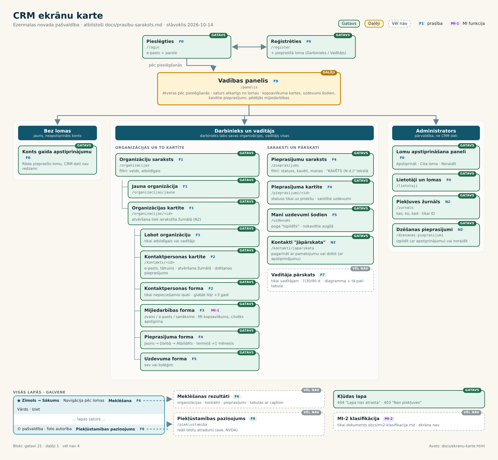

# CRM ekrānu karte

> Ezermalas novada pašvaldības CRM · mācību prototips · stāvoklis 2026-10-14
> Atbilst [prasibu-saraksts.md](prasibu-saraksts.md). Paneļa detalizēts apraksts: [vadibas-panelis.md](vadibas-panelis.md).



**Apzīmējumi:** ✅ gatavs · 🟡 daļēji · ⬜ vēl nav. Attēlā: zaļš = gatavs, dzeltens = daļēji, pelēks raustīts = vēl nav.

## Ekrāni pa lomām

### Ieeja

| Ekrāns | Adrese | Prasība | Statuss |
|---|---|---|---|
| Pieslēgties | `/login` | F0 | ✅ |
| Reģistrēties (+ pieprasītā loma) | `/register` | F0 | ✅ |
| Vadības panelis: atveras pēc pieslēgšanās, saturs pēc lomas | `/panelis` | F9 | 🟡 |
| Konts gaida apstiprinājumu (lietotājs bez lomas) | `/panelis` | F0 | ✅ |

### Darbinieks un vadītājs

| Ekrāns | Adrese | Prasība | Statuss |
|---|---|---|---|
| Organizāciju saraksts (filtri: veids, atbildīgais) | `/organizacijas` | F1 | ✅ |
| └ Jauna organizācija | `/organizacijas/jauna` | F1 | ✅ |
| └ Organizācijas kartīte (atvēršana žurnālā) | `/organizacijas/<id>` | F1, N2 | ✅ |
| &nbsp;&nbsp;&nbsp;└ Labot organizāciju | `/organizacijas/<id>/labot` | F1 | ✅ |
| &nbsp;&nbsp;&nbsp;└ Kontaktpersonas kartīte (atvēršana žurnālā) | `/kontakti/<id>` | F2, N2 | ✅ |
| &nbsp;&nbsp;&nbsp;└ Kontaktpersonas forma | `/organizacijas/<id>/kontakti/jauns`, `/kontakti/<id>/labot` | F2 | ✅ |
| &nbsp;&nbsp;&nbsp;└ Mijiedarbības forma + MI kopsavilkums | `/organizacijas/<id>/mijiedarbibas/jauna` | F3, MI-1 | ✅ |
| &nbsp;&nbsp;&nbsp;└ Pieprasījuma forma | `/organizacijas/<id>/pieprasijumi/jauns`, `/pieprasijumi/<id>/labot` | F4 | ✅ |
| &nbsp;&nbsp;&nbsp;└ Uzdevuma forma | `/uzdevumi/jauns` | F5 | ✅ |
| Pieprasījumu saraksts (statuss, kavēti, manas) | `/pieprasijumi` | F4 | ✅ |
| └ Pieprasījuma kartīte (statuss uz priekšu, uzdevumi) | `/pieprasijumi/<id>` | F4 | ✅ |
| Mani uzdevumi šodien (vadītājam visi) | `/uzdevumi` | F5 | ✅ |
| Kontakti "Jāpārskata" (pagarināt / dzēst ar apstiprinājumu) | `/kontakti/japarskata` | N2 | ✅ |
| Vadītāja pārskats (tikai vadītājam) | — | F7 | ⬜ |

### Administrators

| Ekrāns | Adrese | Prasība | Statuss |
|---|---|---|---|
| Lomu apstiprināšana panelī (Apstiprināt / Cita loma / Noraidīt) | `/panelis` | F0 | ✅ |
| Lietotāji un lomas | `/lietotaji` | F0 | ✅ |
| Piekļuves žurnāls | `/zurnals` | N2 | ✅ |
| Dzēšanas pieprasījumi (izpildīt ar apstiprinājumu / noraidīt) | `/dzesanas-pieprasijumi` | N2 | ✅ |

### Visās lapās

| Elements | Prasība | Statuss |
|---|---|---|
| Galvene: zīmols → Sākums, navigācija pēc lomas, vārds, **Iziet** | F0, F9 | ✅ |
| Galvene: meklēšanas lauks → Meklēšanas rezultāti | F6 | ⬜ |
| Kājene: foto autorība | — | ✅ |
| Kājene: saite uz Piekļūstamības paziņojumu (`/pieklustamiba`) | F8 | ⬜ |
| Kļūdas lapa (404, 403) | — | ✅ |
| MI-2 klasifikācija: tikai dokuments, ekrāna nav | MI-2 | ⬜ |

**Kopā:** gatavi 21 · daļēji 1 · vēl nav 4.

## Kā atjaunot attēlu

Attēla avots ir [ekranu-karte.html](ekranu-karte.html). Kad ekrāns tiek uztaisīts, tajā nomaina klasi `todo` uz `done` (vai `part`) un uzrakstu `VĒL NAV` uz `GATAVS`, tad izpilda:

```bash
make ekranu-karte
```

Vienreiz jāuzstāda Playwright ar pārlūku:

```bash
pip install playwright
python -m playwright install chromium
sudo env PYTHONPATH="$(python -c 'import site; print(site.getusersitepackages())')" python -m playwright install-deps chromium
```

Tajā pašā komitā atjauno arī tabulas šajā failā.
